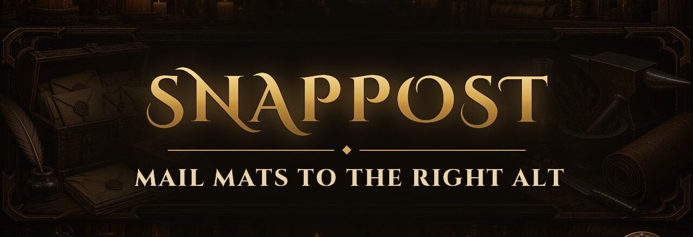

**Map profession materials across your alts and mail them with safe delays.**  
One addon for **WoW Forever**, **Classic Era** and **Midnight / Mainline**.


---

SavedVariables: `SnapPostForeverDB` (does not share maps with any legacy `SnapPost/` package).

## Features

- **Scan** each alt’s professions (`/spostf scan`)
- **Mapper** — alt sidebar, profession chips, search, shared mats, per-item claims
- **Mailbox prompt** — icons, skip stacks, delayed sends
- **DE greens** — optional low-value Uncommon gear to your enchanter
- **First-open guide** + Options + minimap button

## Commands

| Command | Action |
|---------|--------|
| `/spostf` | Open mapper |
| `/spostf options` | Options → AddOns |
| `/spostf minimap` | Show / hide minimap icon |
| `/spostf de <Char-Realm>` | DE greens target (`clear` to remove) |
| `/spostf scan` | Save this character’s professions |
| `/spostf bags` | Mail plan (mailbox open to send) |
| `/spostf delay N` | Seconds between sends |
| `/spostf reset` | Clear maps (keeps scanned characters) |
| `/spostf setmail Char-Realm - Name` | Exact mailbox **To** text |

Also accepts `/snappostf` and `/snappost`.

## Install

1. Install from CurseForge (when published) or copy this folder into `Interface/AddOns/SnapPostForever`.
2. Clients: Forever `_forever_`, Classic Era `_classic_era_`, Midnight `_retail_` / `_ptr_`.
3. **Full client restart** after adding the addon or changing the `.toc`.
4. Log each alt → `/spostf scan` → map materials → open mailbox → Send.

TOC: `## Interface: 11509, 16001, 120105, 120107` · `AllowLoadGameType: forever, standard, vanilla`.

Maintainer deploy / package (WoWAddons workspace):

```bash
./scripts/deploy_snappost_forever.sh              # every installed client
./scripts/deploy_snappost_forever.sh --watch era  # Classic Era only, redeploy on save, then /reload
./scripts/package_snappost_forever.sh   # → dist/SnapPostForever-<version>.zip
```

## Client differences

| | Forever | Classic Era | Midnight / Mainline |
|--|---------|-------------|---------------------|
| Materials | Classic Forever pack | Classic Forever pack | Catalog + DF + TWW + Midnight |
| Expansions | Classic | Classic | Classic → Midnight |
| Professions | Vanilla + First Aid | Vanilla + First Aid | Retail set (JC / Inscription; no First Aid) |
| Names | First + surname | Name-Realm | Name-Realm |

On Classic Era, professions are read from the Skills tab; keep its Professions and Secondary Skills headers expanded when you run `/spostf scan`.

## Documentation

| Doc | Purpose |
|-----|---------|
| [`CHANGELOG.md`](CHANGELOG.md) | Version history |
| [`docs/DESCRIPTION.md`](docs/DESCRIPTION.md) | CurseForge / store description |
| [`docs/CURSEFORGE.md`](docs/CURSEFORGE.md) | Publishing checklist |
| [`docs/screenshots/`](docs/screenshots/) | Screenshot notes |
| [`CONTRIBUTING.md`](CONTRIBUTING.md) | **No external PRs** — maintainer rules |
| [`AGENTS.md`](AGENTS.md) | Instructions for AI coding tools |
| [`LICENSE`](LICENSE) | All Rights Reserved |

## Related

- [ProfessionMaster](https://github.com/Terynas/ProfessionMaster) — craft toasts + alt profession browser
- [First Timers](https://github.com/Terynas/First-Timers) — learn to write WoW addons

## Credits

Author: **Terynas**. Not affiliated with Blizzard Entertainment. World of Warcraft is a trademark of Blizzard Entertainment, Inc.
